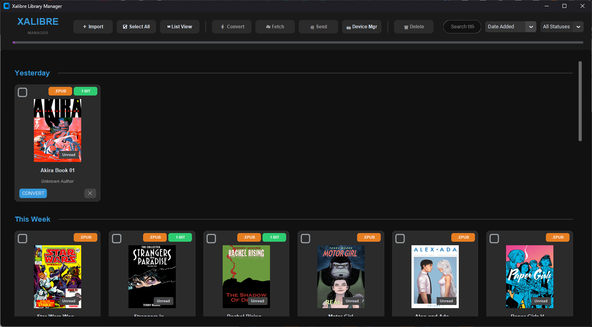
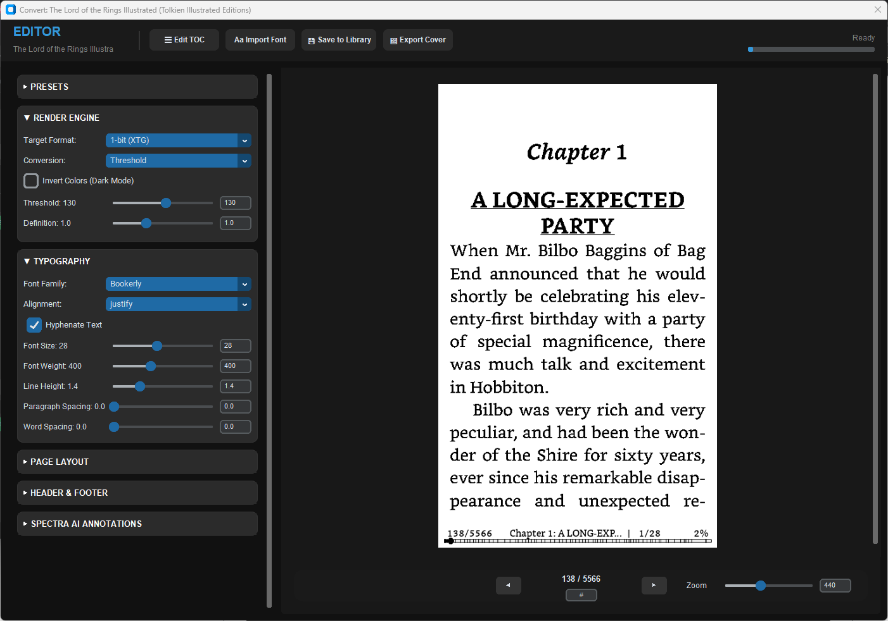

# Xalibre Library Manager & Converter

**Xalibre** is an e-book management suite and rendering pipeline designed to organize digital libraries, curate metadata, and convert books and comics into the optimized **XTC** format for e-ink devices (including the Xteink X4).

Formerly known as *Epub2XTC*, Xalibre has grown into a full-featured desktop library manager with cross-platform support for Windows and macOS.

---

## Features

- **Multi-Format Ingestion**: Import EPUB, CBZ, CBR, PDF, MOBI, AZW, FB2, and plain text files. Non-EPUB formats are automatically normalized for rendering.
- **EPUB to XTC Conversion Engine**: Generate 1-bit (XTG, high-contrast monochrome) or 2-bit (XTH, 4-level grayscale) bitmap streams tailored for e-ink refresh rates and contrast curves.
- **Advanced Dithering**: Choose between Bayer 8x8 ordered dithering (ideal for manga screentones), Atkinson error diffusion (sharp text without background noise), or Floyd-Steinberg, with optional C acceleration.
- **Spectra AI (Vocabulary Assistant)**: "Word Wise"-style automated lexical glosses. Uses Age of Acquisition (AoA) linguistics data and OpenAI models to detect challenging words and insert inline definitions or translations above text.
- **Inline Footnotes**: Automatically detects endnotes and footnotes across chapters and renders them directly below the referencing paragraph in clean callout boxes.
- **Metadata Fetching**: Scrape book summaries, publication details, and high-resolution cover artwork from Google Books, Apple Books, and Open Library.
- **Smart Drag-and-Drop**: Drop files into the application to import. Drag book cards or individual badges to extract covers, source EPUBs, or converted XTC files.
- **Wireless Device Sync**: Transfer files directly to the Xteink X4 over local Wi-Fi, dedicated hotspots (`192.168.3.3`), or USB mount points.

---




---

## Supported Input Formats

| Format | Import Pipeline |
| :--- | :--- |
| **EPUB** | Native EPUB parsing, CSS styling, chapter splitting, and metadata extraction. |
| **CBZ / CBR** | Comic book archives with automatic page sorting, orientation detection, and image filtering. |
| **PDF** | Text extraction and image rendering via PyMuPDF. |
| **MOBI / AZW** | Decompression and conversion via `mobi` and optional `ebook-convert` integration. |
| **FB2 / TXT** | Automated structural parsing, encoding detection, and chapter demarcation. |

---

## Getting Started

### Prerequisites

- Python 3.10, 3.11, or 3.12
- Git

### Installation

1. Clone the repository:
   ```bash
   git clone https://github.com/Rafal-P-Mazur/Xalibre.git
   cd Xalibre
   ```

2. Create and activate a virtual environment:
   - **macOS / Linux:**
     ```bash
     python3 -m venv .venv
     source .venv/bin/activate
     ```
   - **Windows (PowerShell):**
     ```powershell
     python -m venv .venv
     .venv\Scripts\Activate.ps1
     ```

3. Install dependencies:
   ```bash
   pip install -r requirements.txt
   ```

4. (Optional) Compile C Dithering Accelerator:
   - **macOS / Linux:**
     ```bash
     clang -O3 -shared -fPIC dither_accel.c -o dither_accel.dylib
     ```
   - **Windows:**
     A precompiled `dither_accel.dll` is used, or fallback pure Python/NumPy logic runs automatically.

5. Launch Xalibre:
   ```bash
   python Xalibre.py
   ```

---

## Building Standalone Packages

### macOS (`dist/Xalibre.app`)
Run the automated build script:
```bash
chmod +x build_mac.sh
./build_mac.sh
```
Or run PyInstaller with the macOS spec file:
```bash
pyinstaller Xalibre_mac.spec --clean --noconfirm
```
See [README_MAC.md](README_MAC.md) for details on macOS security entitlements and codesigning.

### Windows (`dist/Xalibre.exe`)
```powershell
pyinstaller Xalibre_windows.spec --clean --noconfirm
```

---

## Application Layout & Data Storage

On initial launch, Xalibre sets up application data directories:
- **Base Directory**: `~/Xalibre` (configurable in settings)
  - `Library/`: Managed copies of imported books.
  - `Exports/`: Converted files and exported packages.
  - `Presets/`: Saved converter and layout profiles (`.json`).
  - `Fonts/`: User-installed fonts (`.ttf`, `.otf`) in addition to bundled fonts.
- **Database**: SQLite database stored at `~/Xalibre/xalibre.db`.
- **Configuration**: User preferences saved to `~/Xalibre/default_settings.json` (or `Application Support/Xalibre` on macOS).

---

## Technical Details

- **GUI Framework**: CustomTkinter with TkinterDnD2 drag-and-drop integration.
- **Document & Image Processing**: PyMuPDF (`fitz`), Pillow, NumPy, EbookLib, Beautiful Soup 4.
- **Hyphenation & Linguistics**: Pyphen hyphenation dictionaries and Kuperman Age-of-Acquisition dataset (`AoA_51715_words.csv`).
- **Typography**: Bundled reader fonts including Atkinson Hyperlegible, Charis SIL, DejaVu Sans/Serif, Bookerly, and Literata.

---

## License

This project is licensed under the MIT License. Bundled fonts retain their respective open font licenses (OFL / SIL).
